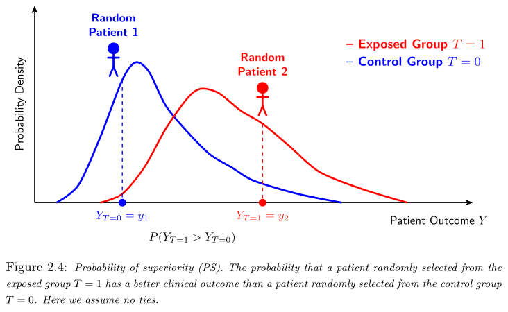
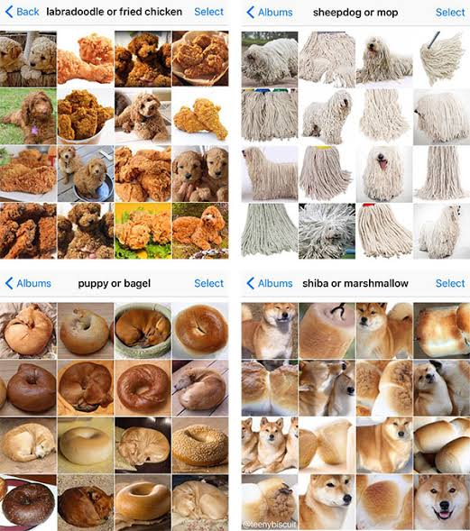
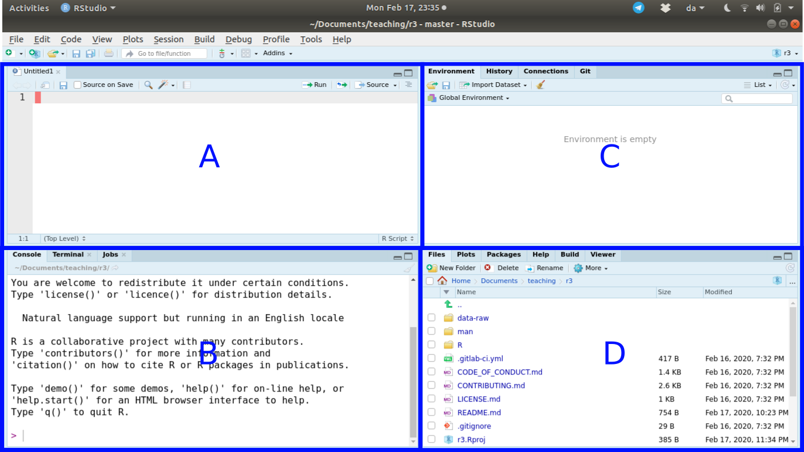

# Evaluating a crystal ball - part 1 {.center .align-center}


## The ABCD Framework {.center .align-center}

A useful way to remember prediction-model evaluation:

- **A** = Calibration-in-the-large
- **B** = Calibration slope
- **C** = C-statistic / Discrimination
- **D** = Decision curve / Clinical usefulness

## Case Study: Cognitive Impairment Prediction

We evaluate a logistic regression model predicting cognitive impairment from:

- Age
- Sex (male)
- Tau protein
- Phosphorylated tau
- Amyloid beta 42
- APOE genotype (6 variants)

**Outcome**: Impaired vs Control (gold-standard neuropsychological testing)

## The Prediction Model

The model was trained on a separate training set:

$$
  impairment_i \sim age + male + tau + p\_tau + Ab\_42 + genotype
$$

where predictors are measured in cerebrospinal fluid via lumbar puncture.

::: {.notes}
Tau and p_tau: biomarkers related to neurofibrillary tangles Ab_42: Amyloid beta
42 forms plaques in Alzheimer's disease Genotype: APOE allele pairs (E2E2, E2E3,
E3E3, E3E4, E2E4, E4E4)
:::

## Dataset Visualization {.r-stretch}

```{r}
#| label: data-plt1
#| fig-cap: "Tau vs p-tau by genotype and diagnosis"

library(dplyr)
library(ggplot2)

ad_data <- medisr::ad_data

ad_data$diagnosis <- factor(
    ad_data$diagnosis,
    levels = c("Impaired", "Control"),
    labels = c("impaired", "control")
)

ad_data$Genotype <- factor(ad_data$Genotype,
  levels = c("E3E3", "E3E4", "E4E4", "E2E3", "E2E4", "E2E2"),
  labels = c("E2E2", "E2E3", "E3E3", "E3E4", "E2E4", "E4E4")
)

test <- ad_data[seq(1, nrow(ad_data), by = 2), ]

p1 <- ggplot(test, aes(tau, p_tau, colour = diagnosis)) +
  geom_point(
    aes(alpha = factor(male)),
    size = 2.4,
    position = position_jitter(width = 0.03, height = 0.03)
  ) +
  facet_wrap(~ Genotype) +
  scale_alpha_manual(
    values = c(`0` = 0.55, `1` = 0.9),
    name = "Male"
  ) +
  labs(
    x = "Tau",
    y = "p-tau",
    colour = "Diagnosis"
  ) +
  theme_minimal(base_size = 12) +
  theme(
    panel.grid.minor = element_blank(),
    legend.position = "bottom"
  )

p1
```

## Biomarker Distributions {.r-stretch}

```{r}
#| label: data-plt2
#| fig-cap: "Distribution of biomarkers by diagnosis"

library(tidyr)

biomarkers <- test |>
  pivot_longer(
    cols = c(tau, p_tau, Ab_42),
    names_to = "biomarker",
    values_to = "value"
  )

p2 <- ggplot(
  biomarkers,
  aes(diagnosis, value, fill = diagnosis)
) +
  geom_violin(
    alpha = 0.25,
    colour = NA,
    trim = FALSE
  ) +
  geom_boxplot(
    width = 0.18,
    outlier.shape = NA,
    alpha = 0.65
  ) +
  geom_jitter(
    width = 0.08,
    height = 0,
    size = 1.4,
    alpha = 0.55
  ) +
  facet_wrap(~ biomarker, scales = "free_y") +
  labs(
    x = NULL,
    y = NULL,
    fill = "Diagnosis"
  ) +
  theme_minimal(base_size = 12) +
  theme(
    panel.grid.minor = element_blank(),
    legend.position = "bottom"
  )

p2
```

# Evaluating Prediction Models

## What We Need

A prediction model can be evaluated from two things:

- What actually happened (observed outcome)
- What the model predicted (predicted probabilities)

Here we use predictions from a pre-trained logistic regression model.

::: {.notes}
We work with ad_validation_logistic which contains: - Class: the observed
outcome - .pred_impaired: predicted probability of impairment

No need to fit a model; we simply evaluate its predictions.
:::

## The Validation Data

```{r}
#| label: get-data
#| echo: false

ad_validation_logistic <- medisr::ad_validation_logistic
```

Class = observed outcome. `.pred_impaired` = predicted probability of
impairment.

```{r}
#| label: looking-at-data
#| echo: false

head(ad_validation_logistic)
```

::: {.notes}
The dataset contains 167 observations with: - Class: factor with levels
"control" and "impaired" - .pred_impaired: numeric predicted probabilities
:::

## Confusion Matrix

How many were correctly classified?

```{r}
#| label: conf-mat-prep
#| echo: false

library(probably)

predictions <- ad_validation_logistic |>
    mutate(
        .pred_class = probably::make_two_class_pred(
            .pred_impaired,
            levels(Class),
            threshold = 0.5 )
        )
```

```{r}
#| label: conf-mat
#| fig-cap: "Confusion matrix for threshold = 0.5"

library(yardstick)

conf_mat(
  predictions,
  truth = Class,
  estimate = .pred_class
)
```

::: {.notes}
Pattern observed: - Many more control participants (123) than cognitively
impaired (44) - Only 25/44 impaired were labeled correctly (56.8%) - 109/123
controls were labeled correctly (88.6%)

The model is much better at identifying controls than impaired participants.
:::

## Accuracy: How Often Correct? {.center}

> How often does the model get the class right?

$$
  Accuracy = \frac{TP + TN}{TP + TN + FP + FN}
$$

```{r}
#| label: accuracy

accuracy(predictions, Class, .pred_class)
```

**Accuracy = 0.802** (80.2% classified correctly)

## The Problem with Accuracy {.center}

Accuracy is easy to understand but has an important limitation.

::: {.fragment}
It does not tell us **which class** the model gets wrong.
:::

::: {.fragment}
It can be misleading when classes are **unbalanced**.
:::

::: {.fragment}
Example: If 95% are controls, a model that always predicts "control" has 95%
accuracy, despite failing to identify **any** impaired participants.
:::

## Specificity: Avoiding False Positives {.center}

> Among people who are **not** "impaired", how many does the model correctly
> identify?

Specificity measures how well the model identifies the **negative class**
(controls).

$$
  Sensitivity = \frac{TP}{TP + FN}
$$

```{r}
#| label: specificity

specificity(predictions, Class, .pred_class)
```

**Specificity = 0.886** (88.6% of controls correctly identified)

::: {.notes}
A highly specific model produces few false positives: it rarely labels a control
as impaired.

Particularly useful when false positives are costly (e.g., unnecessary
treatment, concern).
:::

## Sensitivity: Avoiding False Negatives {.center}

> Among people who **are** "impaired", how many does the model correctly
> identify?

Sensitivity measures how well the model identifies the **positive class**
(impaired).

$$
  Specificity = \frac{TN}{TN + FP}
$$

```{r}
#| label: sensitivity

sensitivity(predictions, Class, .pred_class)
```

**Sensitivity = 0.568** (56.8% of impaired correctly identified)

::: {.notes}
A highly sensitive model produces few false negatives: it rarely misses an
impaired participant.

Our model has high specificity (good at recognizing controls) but lower
sensitivity (misses substantial proportion of impaired).

This distinction is crucial for understanding model performance.
:::

## Sensitivity vs Specificity {.center .r-fit-text}

::: {.columns}
::::: {.column}
### Specificity = 88.6%

- Good at identifying controls
- Few false positives
- Conservative about calling impairment

::::::: {.column}
### Sensitivity = 56.8%

- Misses many impaired cases
- More false negatives
- Not aggressive enough
:::::::
:::::
:::

## Discussion Task {.center}

**Discuss with your neighbor:**

- Which diagnosis would you prefer a **lower** probability threshold? Why?
- Which diagnosis would you prefer a **higher** probability threshold? Why?

Consider consequences: - Cost of treatment - Side-effects - Effectiveness of
treatment

::: {.notes}
Sensitivity and specificity depend on the chosen probability threshold.

Lower threshold: more willing to classify as impaired → higher sensitivity,
lower specificity Higher threshold: more conservative → higher specificity,
lower sensitivity

The "right" threshold depends on the costs of false positives vs false
negatives.
:::

## ROC and AUC

Instead of choosing one threshold, we can look at model discrimination across
**all** possible thresholds.

The ROC curve shows sensitivity against 1 − specificity.

```{r}
#| label: roc
#| fig-cap: "ROC curve for cognitive impairment prediction"

roc_curve(ad_validation_logistic, Class, .pred_impaired, event_level = "first" ) |>
    autoplot()
```

## Area Under the Curve

```{r}
#| label: auc

roc_auc(ad_validation_logistic, Class, .pred_impaired)
```

**AUC** = area under the ROC curve

::: {.notes}
AUC can be interpreted as the probability that the model assigns a higher
predicted probability to a randomly chosen "impaired" observation than to a
randomly chosen "control" observation.

AUC measures **discrimination** (how well the model distinguishes between
classes). It does NOT tell us whether the predicted probabilities themselves are
accurate.
:::

## Key Idea

> No single metric evaluates a prediction model completely.

A useful model should:

- Discriminate well - Produce sensible probabilities
- Lead to better decisions

## From Data to Probability {.center}

```{mermaid}
%%| label: bug-in-prop-out

flowchart LR
    A["🐛"] --> B["Model prediction"] --> C["0.18"]

    style B fill:#FFF0D9,stroke:#D99024,color:#222
    style C fill:#E2F0D9,stroke:#548235,color:#222
```

## From Data to Probability {.center}

```{mermaid}
%%| label: smiley-in-prop-out

flowchart LR
    A["😄"] --> B["Model prediction"] --> C["0.84"]

    style B fill:#FFF0D9,stroke:#D99024,color:#222
    style C fill:#E2F0D9,stroke:#548235,color:#222
```

## ABCD Framework in Detail {.center .align-center}

::: {layout-ncol=2}
{fig-align="center"}
{fig-align="center"}
:::

## Model calibration

So the CITL measures a systematic bias: the average predicted probability is too
large. The calibration slope is a measure of the association between observed
and predicted tisk of the outcome event across the whole range of predicted
risks. So not a systematic error, but a errors across the prediction range.

```{r}
#| label: calibration-ggplot

# Create calibration curves
calibration_data <- tibble(
  x = seq(0, 1, length.out = 300)
) |>
  mutate(
    `Calibration slope issue at edges` = x^1.5 + 0.1,
    `Systematic underconfidence` = x + 0.6 * sin(2 * pi * x)
  ) |>
  pivot_longer(
    cols = -x,
    names_to = "model",
    values_to = "event_proportion"
  )

# Plot
ggplot(calibration_data,
       aes(x = x, y = event_proportion)) +
  geom_abline(
    slope = 1, intercept = 0,
    linetype = "dashed",
    color = "grey50",
    linewidth = 0.8
  ) +
  geom_line(
    color = "#2878B5",
    linewidth = 1.2
  ) +
  facet_wrap(~ model, nrow = 1) +
  scale_x_continuous(
    limits = c(0, 1),
    breaks = seq(0, 1, 0.2),
    expand = c(0, 0)
  ) +
  scale_y_continuous(
    limits = c(0, 1),
    breaks = seq(0, 1, 0.2),
    expand = c(0, 0)
  ) +
  coord_equal() +
  labs(
    x = "Predicted probability",
    y = "Observed event proportion"
  ) +
  theme_minimal(base_size = 13) +
  theme(
    panel.grid.minor = element_blank(),
    strip.text = element_text(face = "bold"),
    panel.spacing = grid::unit(1.5, "lines")
  )
```

## Are the Probabilities Accurate? {.center}

Calibration asks a different question:

> When the model says 70%, does the event happen about 70% of the time?

A simple calibration plot compares predicted probability with the observed
proportion.

::: {.notes}
Calibration is about the **accuracy of the probabilities**, not just the
rankings.

A model can have excellent discrimination (high AUC) and poor calibration
(probabilities don't match observed frequencies).

The calibration model can be written as a logistic regression of the outcome on
the logit of the predicted probability.
:::

## A: Calibration in the large

<!-- TODO: meme -->

> Are predictions systematically too high or too low?

Calibration-in-the-large (CITL) assesses whether predicted risks are
systematically too high or too low overall.

## Calibration-in-the-large

To estimate the **CITL**, we use the following logistic regression model:

$$
  logit(P(Y = 1)) = α + \text{offset}(logit(\hat{p}_i))
$$

- $\hat{p}_i$ is the predicted risk from the prediction model
- the coefficient of logit($\hat{p}_i$) is fixed at 1.

The estimated intercept α is the calibration-in-the-large.

- citl = 1: no overall calibration-in-the-large error.
- citl < 1: predicted risks are too high on average.
- citl > 1: predicted risks are too low on average.

## Calibration-in-the-large part 2 (repeat?)

- Poisson regression offset: adjusts the expected count for exposure,
- Logistic regression contributes a known term to the log-odds, with its
  coefficient fixed at 1.

Our model is:

$$
  logit(q_i) = α + \text{offset}(o_i)
$$
where $o_i$ are the logit-transformed estimated probabilities from the
prediction-model,

$$
  o_i = logit(\hat{p}_i)
$$

```{r}
#| label: cal-model-confusion
#| echo: false

citl_model <- ad_validation_logistic |>
  mutate(
    outcome = Class == "impaired",
    logit_p = log(.pred_impaired / (1 - .pred_impaired))
  ) |>
  glm(outcome ~ 1 + offset(logit_p),
      data = _, family = binomial())

broom::tidy(citl_model, conf.int = TRUE, exponentiate = TRUE)
```

## B: The calibration slope

> Are predictions too extreme or not extreme enough?

To estimate the calibration **slope**, we use another logistic regression model:

$$
  logit(P(Y = 1)) = α + ζlogit(\hat{p})
$$

- estimating ζ (*"zeta"*),

also estimates a separate intercept α.

- ζ = 1: ideal calibration slope.
- ζ < 1: typically indicates overfitting, with predictions that are too extreme.
- ζ > 1: typically indicates underfitting, with predictions that are not extreme
  enough.

```{r}
#| label: cal-model-confusion1
#| echo: false

slope_model <- ad_validation_logistic |>
    mutate(
        outcome = Class == "impaired",
        logit_p = log(.pred_impaired / (1 - .pred_impaired))
    ) |>
        glm(outcome ~ logit_p, data = _, family = binomial)

broom::tidy(slope_model, conf.int = TRUE) # don't exponentiate!
```

## Visualizing calibration

<!--panache-ignore-start-->
| Bin | Mean predicted risk (x-axis) | Observed outcome proportion (y-axis) | Interpretation |
|:---|---:|---:|:---|
| 1 (0%---19%) | 5% | 4% | Slight overprediction |
| 2 (20%---39%)| 15% | 15% | Perfect calibration |
| 3 (40%---59%) | 30% | 35% | Underprediction |
| 4 (60%---79%) | 50% | 45% | Overprediction |
| 5 (80%---100%) | 80% | 75% | Overprediction |
<!--panache-ignore-end-->

## Calibration plot

```{r}
#| label: fig-calibration
#| echo: false

cal_plot_breaks(
    ad_validation_logistic,
    Class,
    .pred_impaired,
    num_breaks = 5 # number of bins we want
    )
```

## Discrimination using the concordance statistic

<!-- TODO: insert jan's picture of concordance + AUC! -->

{fig-align="center"}

## D: Decision Curve

> Does using the model improve clinical decisions?

*More in Case 3* - not discussed in this session!

## Internal validation

{fig-align="center"}

## Cross-validation

```{mermaid}
%%| label: fig-cross-validation
%%| fig-cap: Cross-validation for internal validation'.
%%| echo: false
%%| eval: true

flowchart LR
    subgraph CV["5-Fold Cross-Validation"]
        direction TB

        subgraph R1["Iteration 1"]
            direction LR
            A11["Test"]:::test --- A12["Train"]:::train --- A13["Train"]:::train --- A14["Train"]:::train --- A15["Train"]:::train
        end

        subgraph R2["Iteration 2"]
            direction LR
            A21["Train"]:::train --- A22["Test"]:::test --- A23["Train"]:::train --- A24["Train"]:::train --- A25["Train"]:::train
        end

        subgraph R3["Iteration 3"]
            direction LR
            A31["Train"]:::train --- A32["Train"]:::train --- A33["Test"]:::test --- A34["Train"]:::train --- A35["Train"]:::train
        end

        subgraph R4["Iteration 4"]
            direction LR
            A41["Train"]:::train --- A42["Train"]:::train --- A43["Train"]:::train --- A44["Test"]:::test --- A45["Train"]:::train
        end

        subgraph R5["Iteration 5"]
            direction LR
            A51["Train"]:::train --- A52["Train"]:::train --- A53["Train"]:::train --- A54["Train"]:::train --- A55["Test"]:::test
        end
    end

    A15 ~~~ M1["Metric 1"]:::metric
    A25 ~~~ M2["Metric 2"]:::metric
    A35 ~~~ M3["Metric 3"]:::metric
    A45 ~~~ M4["Metric 4"]:::metric
    A55 ~~~ M5["Metric 5"]:::metric

    M1 --> AVG["Average<br/>performance"]:::average
    M2 --> AVG
    M3 --> AVG
    M4 --> AVG
    M5 --> AVG

    classDef train fill:#55c5d5,stroke:#55c5d5,color:#000
    classDef test fill:#d91b91,stroke:#d91b91,color:#fff
    classDef metric fill:#8cf4f5,stroke:#8cf4f5,color:#000
    classDef average fill:#8cf4f5,stroke:#8cf4f5,color:#000
    style CV fill:transparent,stroke:transparent
    style R1 fill:transparent,stroke:transparent
    style R2 fill:transparent,stroke:transparent
    style R3 fill:transparent,stroke:transparent
    style R4 fill:transparent,stroke:transparent
    style R5 fill:transparent,stroke:transparent
```

## External validation {.smaller}

1. **Temporal validation:**\
   Develop the model using data from an earlier time period and evaluate it
   using patients from a later time period. This tests whether the model
   continues to work as patients and clinical practice change over time.

2. **Geographical validation:**\
   Develop the model using data from one geographical location, such as a
   hospital or country, and evaluate it using data from another location. This
   tests whether the model generalises to a different population or healthcare
   setting.

3. **Domain validation:**\
   Develop the model in one type of healthcare setting and evaluate it in
   another. For example, a model developed using patients from a specialist
   hospital could be evaluated in primary care.

4. **Cross-setting validation:**\
   Develop the model using one study and evaluate it using an entirely
   independent study. This is often the strongest form of external validation
   because the validation data were collected independently of the model
   development process.

## When to use internal and external validation? {.center style="text-align: center;"}

<!-- TODO: find meme -->

{fig-align="center"}

## Sample size calculation in binary prediction studies {.center style="text-align: center;"}

<!-- TODO: find meme -->
{fig-align="center"}

## Manual SSC {.center .align-center}

For sample-size planning, we need to select:

- the anticipated *C*-statistic, $C$;
- the anticipated event proportion, $\phi$; and
- the desired precision, expressed as $SE(C)$.

## Using the C-statistic {.smaller}

$$
  𝑆𝐸(𝐶)
  ≈ \frac{\sqrt{𝐶(1 − 𝐶) (1 + (𝑁𝜙 − 1)1 − 𝐶2 − 𝐶 + (𝑁(1 − 𝜙) − 1)𝐶1 + 𝐶)}} {𝑁2𝜙(1 − 𝜙)}.
$$

$$
  𝐶 = 0.70, \\
  𝜙 = 0.10.
$$

If we want the *C*-statistic to have an approximate 95% confidence interval of
$\pm0.05$, we need approximately

$$
  𝑆𝐸(𝐶) = \frac{0.05}{1.96} ≈ 0.0255.
$$
## Rewritten {.center .align-center}

::: {.r-fit-text}
$$
  SE(C)
  \approx \sqrt{\frac{0.70(1 - 0.70)}{1413^2(0.10)(1 - 0.10)} \Bigg[1 + (1413 \times 0.10 - 1)\frac{1 - 0.70}{2 - 0.70} + (1413 \times (1 - 0.10) - 1)\frac{0.70}{1 + 0.70}\Bigg]}
  \approx 0.0255
$$
:::

## In practice:

- Here, we try values `N  <- 1000:1500`
- confidence bound = 0.10
- prevalence = 0.70

```{r}
#| label: manual-ssc-in-r
#| warning: false

# Our selected values
p  <- 0.70
n  <- 1000:1500
pi <- 0.10

# Compute the first fraction
broek <- (p * (1 - p)) / (n^2 * pi * (1 - pi))

# Break up the large formula insude the square brackets [ ] at every plus sign
led_1 <- 1
led_2 <- (n * pi - 1) * ((1 - p) / (2 - p))
led_3 <- (n * (1 - pi) - 1) * (p / (1 + p))

# Take the sqrt of it all
SE_C <- sqrt(broek * (led_1 + led_2 + led_3))

# Visualize values
ggplot(data.frame(n,SE_C),aes(n,SE_C)) +
    geom_line() +
    geom_hline(yintercept=0.0255) +
    geom_text(aes(label = "x"), x = 1413, y = 0.0255, size = 5, color = "red")
```

## R's `pmsampsize` library {.center .r-fit-text}

```{r}
#| label: effect-size-on-c-score
#| code-line-numbers: "2|3|4|5"
#| output: false
#| echo: true

pmsampsize::pmsampsize(
    type = "b", # binary
    cstatistic = 0.89, # concordance/AUC
    parameters = 24, # covariates
    prevalence = 0.174 # cognitive impairment
    )
```

## R's `pmsampsize` output {.center .r-fit-text}

```{r}
#| label: effect-size-on-c-score2
#| echo: false
#| output: true

pmsampsize::pmsampsize(
    type = "b", # binary
    cstatistic = 0.89, # concordance/AUC
    parameters = 24, # covariates
    prevalence = 0.174 # cognitive impairment
    )
```

# Summary: Evaluation Toolkit {.smaller}

  | Question                                             | Measure         |
  | ---------------------------------------------------- | --------------- |
  | Does the model classify correctly at this threshold? | Accuracy        |
  | Does it avoid false positives?                       | Specificity     |
  | Does it avoid false negatives?                       | Sensitivity     |
  | Can it distinguish the two outcomes?                 | ROC / AUC       |
  | Are the probabilities accurate?                      | Calibration     |
  | Does it improve clinical decisions?                  | Decision curve  |
  | What is the effect of a predictor?                   | Effect estimate |
