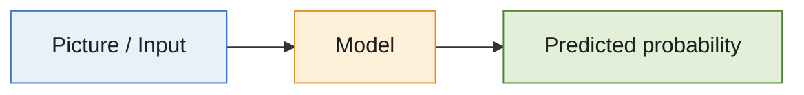
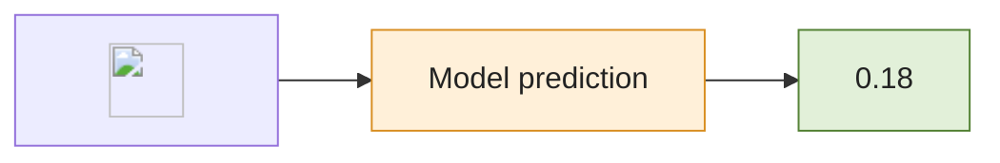
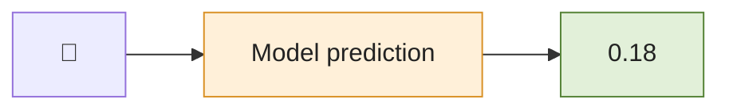

## From Data to Probability {.center}








```mermaid
flowchart LR
    A@{img: "../slides/images/DanielSkakMazhariJensen.jpg"} --> B["Model prediction"] --> C["0.18"]

    style B fill:#FFF0D9,stroke:#D99024,color:#222
    style C fill:#E2F0D9,stroke:#548235,color:#222
```


```mermaid
flowchart LR
    A@{ img: "/Users/ze18rp/code/uni/medicinsk-statistik/slides/images/DanielSkakMazhariJensen.jpg", label: "Example", pos: "b", h: 60, constraint: "on" } --> B["Model"] --> C["Predicted probability"]
```

## From Image to Probability {.center}

<div style="display: flex; align-items: center; justify-content: center; gap: 35px;">

  

  <span style="font-size: 2em;">→</span>

  <div style="background: #FFF0D9; border: 2px solid #D99024;
              border-radius: 8px; padding: 20px 30px;">
    Model prediction
  </div>

  <span style="font-size: 2em;">→</span>

  <div style="background: #E2F0D9; border: 2px solid #548235;
              border-radius: 8px; padding: 20px 30px;">
    0.18
  </div>

</div>

## From Image to Probability {.center}

\`\`\`tikz, model-IO \usetikzlibrary{arrows.meta, positioning}

\tikzset{
  block/.style={
    draw,
    rounded corners=3pt,
    minimum height=1.5cm,
    minimum width=2.5cm,
    align=center,
    font=\large
  },
  arrow/.style={
    -{Stealth[length=3mm]},
    thick
  }
}

\node[inner sep=0pt] (input) {
  \includegraphics[width=3cm,height=2.5cm,keepaspectratio]{/slides/images/dataviz-3d.png}
};

\node[block, fill=orange!12, right=1.3cm of input] (model) {
  Model
};

\node[block, fill=green!12, right=1.3cm of model] (prob) {
  Predicted\\probability
};

\draw[arrow] (input.east) -- (model.west);
\draw[arrow] (model.east) -- (prob.west);
\`\`\`
